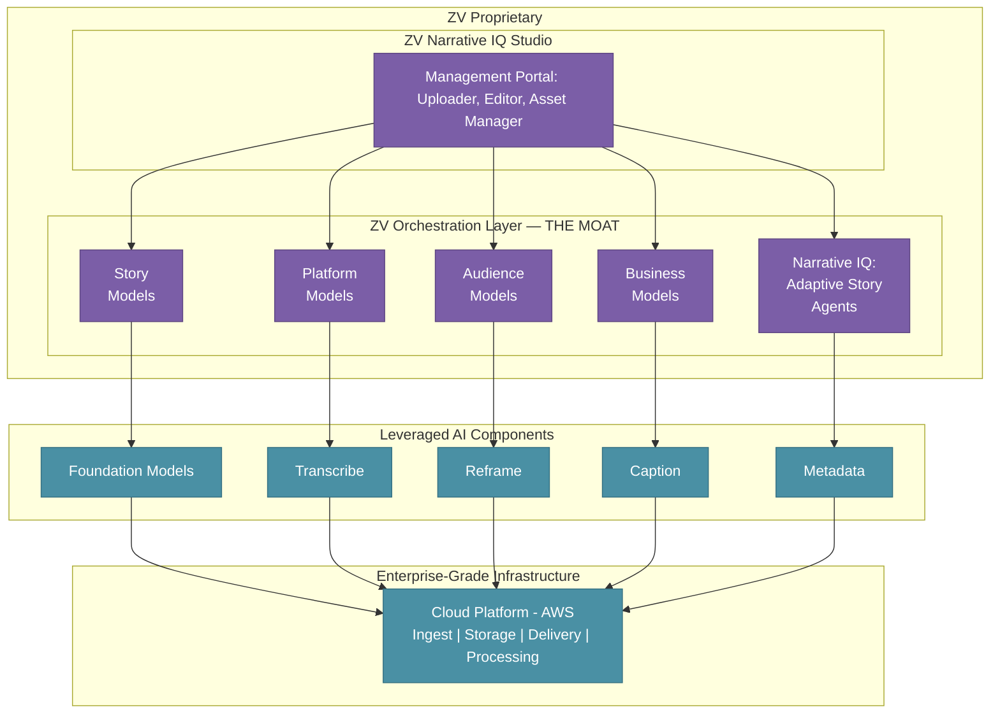
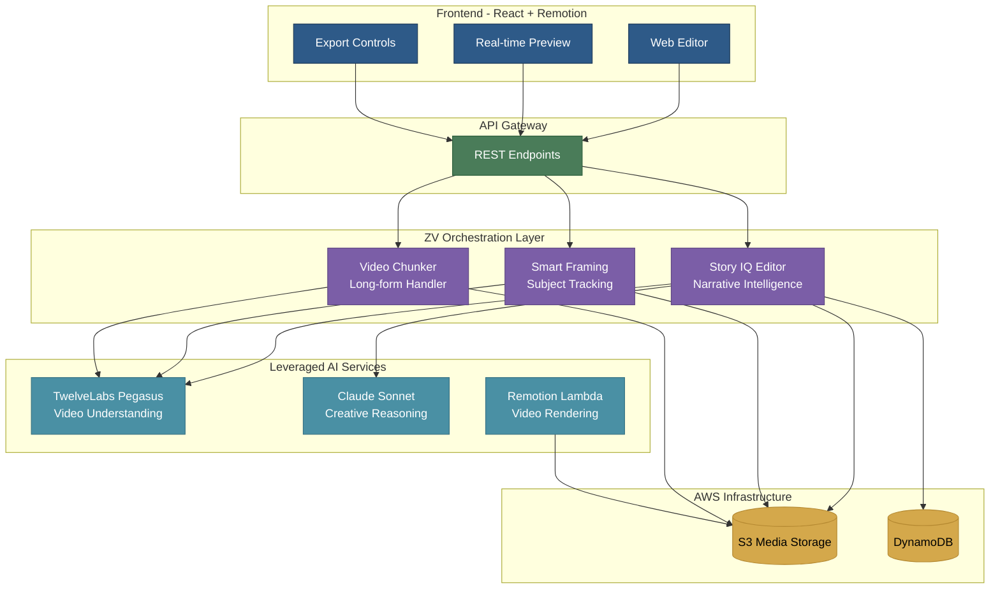
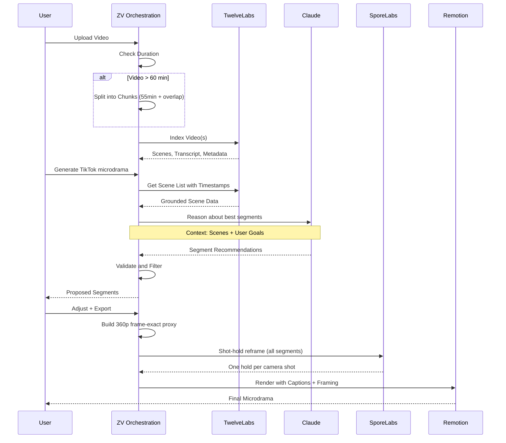
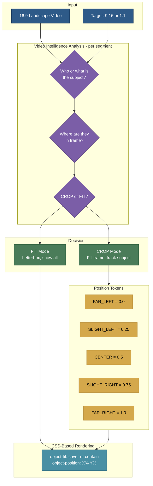
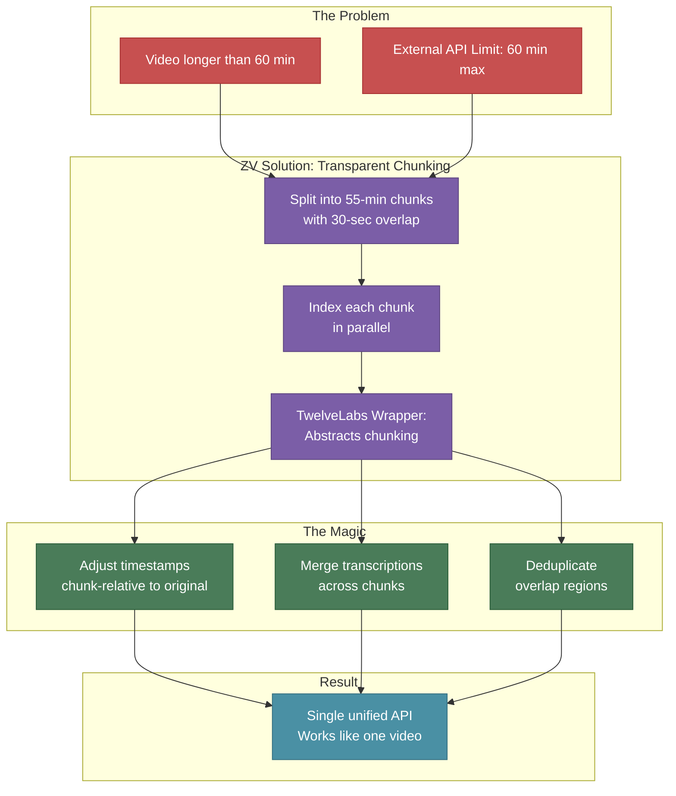
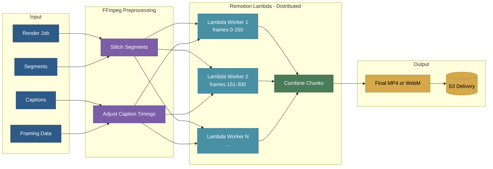
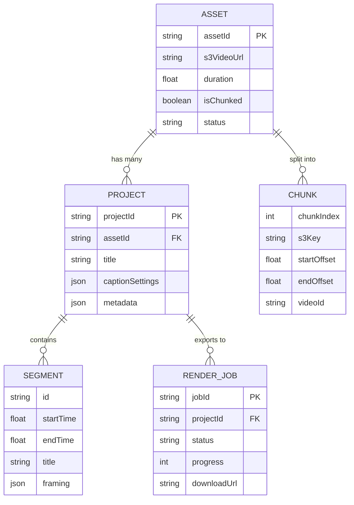
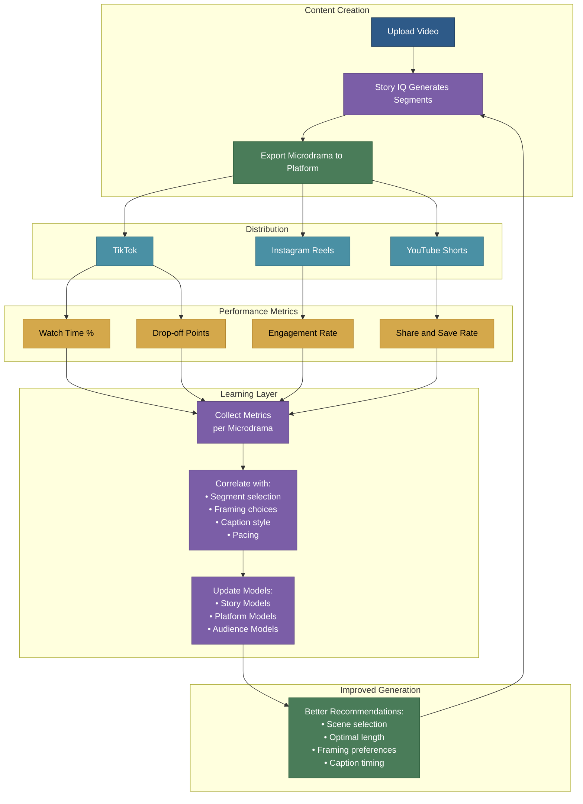
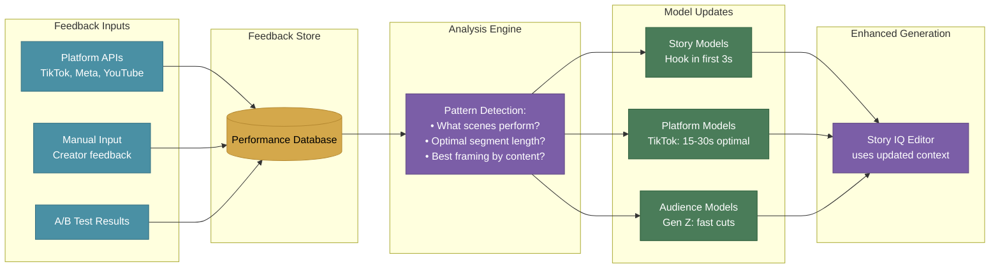

# ZeeVee Architecture Report

_"We don't just wrap the LLM - we give it a film degree."_

---

## The Narrative IQ Tech Stack

---

## System Architecture Overview

---

## Core Workflow: Video to Microdrama

---

## The Story IQ Editor: Two-Stage Intelligence Pipeline

```mermaid
flowchart LR
    subgraph Stage1["Stage 1: PERCEIVE - Video Intelligence"]
        Video["Source Video"]
        TL["TwelveLabs<br/>Pegasus"]
        Ground["Ground Truth:<br/>• Scene timestamps<br/>• Transcript<br/>• Topics and Tags"]
    end

    subgraph Stage2["Stage 2: REASON - Narrative Intelligence"]
        Context["Video Context<br/>+ User Goals"]
        Claude["Claude Sonnet"]
        Plan["Segment Plan:<br/>• Start and End times<br/>• Titles<br/>• Reasoning"]
    end

    subgraph Stage3["Stage 3: VALIDATE"]
        Val["Validation:<br/>• Bounds check<br/>• Min duration<br/>• No overlaps"]
        Output["Final Segments<br/>for Microdrama"]
    end

    Video --> TL
    TL --> Ground
    Ground --> Context
    Context --> Claude
    Claude --> Plan
    Plan --> Val
    Val --> Output

    style Video fill:#2E5A88,stroke:#1E3A58,color:#FFFFFF
    style TL fill:#4A90A4,stroke:#357082,color:#FFFFFF
    style Ground fill:#4A7C59,stroke:#2A5C39,color:#FFFFFF
    style Context fill:#7B5EA7,stroke:#5D4580,color:#FFFFFF
    style Claude fill:#4A90A4,stroke:#357082,color:#FFFFFF
    style Plan fill:#7B5EA7,stroke:#5D4580,color:#FFFFFF
    style Val fill:#D4A84B,stroke:#B48830,color:#000000
    style Output fill:#4A7C59,stroke:#2A5C39,color:#FFFFFF
```

**Key Design Decision**: Segment recommendations are _grounded_ to actual scene timestamps from video analysis. The language model never hallucinates timestamps—it selects from verified scene data.

---

## Smart Auto-Framing System

**Current engine (`FRAMING_ENGINE=sporelabs`, default)**: `analyzeFraming` builds a 360p, every-frame proxy of the raw master (`proxy/<assetId>.mp4`, fanned out across Lambda slices for long sources) and submits all segments to the SporeLabs shot-hold service. SporeLabs detects camera cuts from pixels and returns one `(zoom, focusX, focusY)` hold per shot, already on the source frame grid; segment bounds are never touched. Long jobs store `framingJob.sporelabsJobId` and continue polling in a fresh invocation. `FRAMING_ENGINE=gemini` restores the legacy per-segment Gemini `TIME|ZOOM` path.

---

## Transparent Chunked Video Processing

**Key Design Decision**: Consumers of the API never need to know if a video was chunked. All timestamps are in the original video's timeline.

---

## Distributed Rendering Pipeline

**Key Design Decision**: ~120 parallel Lambda workers for a 10-minute video. Rendering is massively parallelized for speed.

---

## Data Model (Simplified)

**Terminology:**

- **Asset** = Original uploaded video
- **Project** = A microdrama created from an asset
- **Segment** = A selected portion of the original video
- **Render Job** = An export of a microdrama

---

## Future: Feedback-Driven Learning System

---

### Feedback Loop: Detailed View

**Vision**: The system learns what works. As creators export microdramas and track performance, the Story IQ Editor gets smarter about what segments to recommend, how to frame them, and what pacing works best for each platform and audience.

---

## Key Design Decisions Summary

| Area                      | Decision                                                        | Rationale                          |
| ------------------------- | --------------------------------------------------------------- | ---------------------------------- |
| **Grounded Intelligence** | Two-stage pipeline: Video Intelligence → Narrative Intelligence | Prevents hallucinated timestamps   |
| **Long Videos**           | Transparent chunking with overlap                               | Handles any length, seamless API   |
| **Auto-Framing**          | Shot-hold: one crop per camera shot (SporeLabs)                 | Smooth, grounded, no model clocks  |
| **Rendering**             | Massively parallel Lambda                                       | Fast exports, scales automatically |
| **Preview**               | CSS-based framing                                               | Instant feedback, no re-encoding   |
| **Caption Timing**        | Adjusted for stitched output                                    | Captions stay synced after editing |

---

## How to Use These Diagrams

1. **Copy the Mermaid code blocks** from this document
2. **Paste into any of these free tools:**

   - [Mermaid Live Editor](https://mermaid.live/) — Best for editing and previewing
   - [Draw.io](https://draw.io/) — Import Mermaid, export to Google Drive
   - [Notion](https://notion.so/) — Paste in code block, select "Mermaid"
   - [GitHub](https://github.com/) — Renders in markdown files automatically

3. **For Google Slides or Docs:**
   - Use Mermaid Live Editor → Export as PNG or SVG
   - Insert image into Google Slides/Docs

---

_Document generated for ZeeVee architecture review._
