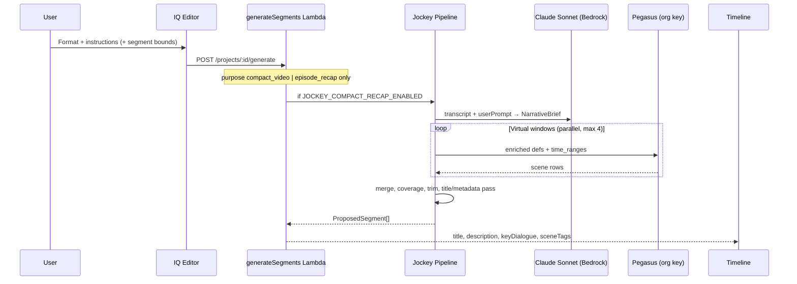

# Jockey Pipeline — Product, UX & Operations Spec

**Status:** Eval-validated locally; **ship on next deploy**  
**Companion docs:** `SOW-jockey-compact-recap.md`, `SPEC-jockey-compact-recap.md`, `backend/EVAL-SUITE.md`  
**Last validated:** July 2026 — Philadelphia compact + Murdoch recap

---

## 1. Executive summary

**Jockey** replaces direct Pegasus segmentation for **Compact** and **Ep Recap** only. It fixes long-form timeline bias and broken recap duration/beat counts that baseline Pegasus exhibits today.

**Launch posture:** Enabled in production on deploy, but **opt-in per request**: the IQ Editor has a "Jockey mode" toggle (off by default) and only requests with `jockeyEnabled: true` route to Jockey. With `JOCKEY_V3_SELF_DIRECTED_ENABLED=true` (current posture), opted-in requests use the v3 self-directed path (`SPEC-jockey-v3-self-directed-cuts.md`); the brief+Pegasus Jockey path remains as the flag-off rollback layer. Default (toggle off) requests always use the pre-Jockey Pegasus pipeline, unchanged. Rollback is instant via the toggle, or via `JOCKEY_V3_SELF_DIRECTED_ENABLED=false` / `JOCKEY_COMPACT_RECAP_ENABLED=false`.

**Locked product decisions:**

| Topic | Decision |
|-------|----------|
| Compact target | **50%** of source duration (backend default) |
| Retain % UI | **Stay disabled** — users cannot change % from frontend |
| Preprocess LLM | **Claude Sonnet via Bedrock** (not Gemini) |
| Asset Type / Platform | **Metadata only** — must **not** affect pipeline routing or prompts |
| Segment titles | **Must be good** — narrative beat labels / transcript-derived; no mechanical `(Part N)` in shipped output |
| Feature flag | **`JOCKEY_COMPACT_RECAP_ENABLED=true`** on deploy; flip to `false` if production misbehaves |

---

## 2. What Jockey is (and isn't)

| Format | API `purpose` | User outcome |
|--------|---------------|--------------|
| **Compact** | `compact_video` | ~**50%** of source length, segments across the **full timeline** |
| **Ep Recap** | `episode_recap` | **4–6 beats**, **~60–90 seconds**, "Previously on…" tone |

**Jockey is not** LangGraph or the TwelveLabs Agents API (`jockey1.0`) in Lambda. Production is a **TypeScript orchestration**:

1. **Claude Sonnet (Bedrock)** — transcript + producer `userPrompt` → **NarrativeBrief**
2. **Pegasus** — virtual **10 min windows**, 60s overlap on long sources (org TwelveLabs key)
3. **Merge + coverage** — fail if output clusters in latter half (compact)
4. **Post-process** — trim to 50% target (compact) or narrow beat windows without dropping below 4 beats (recap)
5. **Title/metadata pass** — map segments to brief beats + transcript; refresh `title`, `reasoning`, `keyDialogue`, `section`

**Unchanged when Jockey is on:** Highlights, Full Video, sports pipeline, export-metadata Lambda, Remotion render.

---

## 3. End-to-end flow



**Routing rule:** Only `purpose` (`format` mapped in `Editor.tsx`) selects Jockey. **`assetType` and `platform` never branch the pipeline.**

---

## 4. IQ Editor — current UX (unchanged at launch)

Panel: `zeevee/src/components/editor/MicroseriesGenerator.tsx`

| Control | Sent to API? | Affects Jockey? | Launch behavior |
|---------|--------------|-----------------|-----------------|
| **Format** | Yes → `purpose` | **Yes** | Compact / Ep Recap → Jockey when flag on |
| **Instructions** | Yes → `userPrompt` | **Yes — main lever** | Fed to Claude preprocess |
| **Segment duration** min/max | Yes | Partial | Windowed Pegasus ignores min/max with `time_ranges`; recap beats sized by pipeline |
| **Retain %** | Would → `targetPercent` | **No** | `RETAIN_ENABLED = false`; **do not enable** — backend uses fixed **50%** |
| **Asset Type** | Yes (metadata) | **No** | Stored on project; export/metadata only |
| **Dist. Platform** | Yes (metadata) | **No** | Stored on project; export/metadata only |
| **Auto-frame** | Yes | No (post-step) | Unchanged |

**Polling:** 30s initial delay, 10s interval, 15 min max (matches 900s Lambda timeout).

**On Jockey failure:** Job fails with error — **no heuristic fallback** when flag is on.

---

## 5. Backend defaults & inputs

### 5.1 Compact target duration

```
targetSeconds = round(videoDuration × 0.50)   // when targetPercent is null/omitted
```

- Apply in `jockey-pipeline.ts` and `pegasus-pipeline.ts` (`COMPACT_DEFAULT_TARGET_PERCENT = 50`).
- Frontend continues to send `targetPercent: null` (Retain picker disabled).
- If frontend ever sends `targetPercent`, backend may honor it — but **launch UI does not**.

### 5.2 Ep Recap

- Default target: **75s**; acceptance band **60–90s**, **4–6 beats**.
- Recap beat source: Claude `recapBeats` (fallback when Pegasus `recap_keep` drops everything).

### 5.3 Producer instructions

Claude uses `userPrompt` for arc naming, theme priority, and recap beat selection. **Always encourage producers to fill this in** for long-form.

### 5.4 Video length → windowing

| Source | Compact | Recap |
|--------|---------|-------|
| ≤ 30 min | Single Pegasus task | Single task if ≤ 60 min |
| > 30 min | 10 min windows, 60s overlap | Single task if ≤ 60 min |
| > 60 min chunked | Windows per physical chunk | Windows only if > 60 min |

Coverage retry: halve window size once; then **throw** (fail job).

---

## 6. Titles & metadata (ship requirement)

Users see segment **titles on the timeline** and **metadata downstream** (export, thumbnails). Shipped Jockey output must meet:

| Field | Requirement |
|-------|-------------|
| `title` | ≤10 words; from **NarrativeBrief beat `label`** when segment midpoint aligns to a beat; else **first transcript sentence** in range. **No `(Part N)` suffixes.** |
| `description` / `reasoning` | Beat role + short editorial note (e.g. `Narrative beat (escalation): …`) |
| `keyDialogue` | Transcript snippet for segment time range (≤2500 chars) |
| `sceneTags` / `section` | `role-{narrativeRole}` when beat-mapped |

**Implementation notes (for eng, not done in this doc):**

1. After enforcer splits oversized Pegasus blobs, **re-title each part** from transcript or nearest brief beat — do not keep parent title + `(Part N)`.
2. Post-enforcer **`applyNarrativeTitles(segments, brief, transcript)`** in `jockey-pipeline.ts`.
3. Deduplicate titles when multiple segments map to the same beat (suffix `(2)` only as last resort).

Eval today still shows `(Part N)` on compact — **fix before or as part of launch deploy.**

---

## 7. Claude preprocess (replaces Gemini)

| Item | Spec |
|------|------|
| Model | **Claude Sonnet** — now `anthropic/claude-sonnet-5.5` via SporeLabs (`SPORELABS_SONNET_MODEL`); originally Bedrock `us.anthropic.claude-sonnet-4-5-20250929-v1:0` |
| Fallback | Direct Anthropic API if Bedrock fails (same pattern as `export-metadata-enrich.ts`) |
| IAM | `bedrock:InvokeModel` — already on `generateSegments` Lambda role |
| Secret | `ANTHROPIC_SECRET_ARN` — already on Lambda; **Gemini not required for Jockey** |
| Input | Truncated transcript + `userPrompt` + title + duration + purpose |
| Output | `NarrativeBrief` JSON (Zod); recap requires **4–6 `recapBeats`** |
| Module | `jockey/preprocess.ts` calls shared Bedrock helper (new `jockey/claude-brief.ts` or reuse export-metadata pattern) |

**Remove** Gemini API key requirement from `generateSegments.ts` when Jockey is enabled.

---

## 8. Eval results (baseline for launch)

### Compact — Philadelphia (59 min), target ~50% ≈ 1,764s

| Approach | Acceptance |
|----------|------------|
| Pegasus baseline | **Fail** — no Q1 coverage |
| Jockey windowed | **Pass** — full timeline spread |
| Jockey + brief preprocess | **Pass** |

### Recap — Murdoch (48 min)

| Approach | Acceptance |
|----------|------------|
| Pegasus baseline | **Fail** — ~1,947s (not a recap) |
| Jockey + brief preprocess | **Pass** — 5 beats, ~70s |

Re-run eval suite after Claude + 50% + title changes land.

### Overnight re-run — July 2 2026 (Claude brief + windowed Pegasus)

| Asset | Purpose | Acceptance | Shipped | Notes |
|-------|---------|-----------|---------|-------|
| Philadelphia (3527s) | Compact | ✓ | 13 seg / 1896s / Q 4-4-3-2 | Coverage/bias fixed; cuts landed on **arbitrary 180s + window-edge points**, not scene ends |
| Murdoch (2884s) | Recap | ✓ | 5 beats / 70s | Passed **only via Claude-brief fallback** — windowed Pegasus returned 0 usable beats |

**Read:** acceptance numbers are met, but through mechanical repair (enforcer split/drop, quartile backfill, recap fallback), not clean editorial cuts. See `SPEC-jockey-v2-loop.md` §13 (findings), §14 (scene-boundary alignment), §15 (Agents-API value gap) for the corrective direction.

---

## 9. Getting the most out of Jockey (current UX)

### Producers — Compact

1. Use **Instructions** — name 2–4 threads/scenes to keep across the full runtime.
2. Pick **Compact** for long-form documentary, interview, episodic archive.
3. After generate, confirm segments appear in **first half** of timeline, not only the end.
4. Trim edges on timeline; titles should already be usable without bulk rename.

### Producers — Ep Recap

1. List **4–6 plot beats in order** in Instructions.
2. Expect **~1 minute** total — not a highlight reel of arbitrary length.
3. Verify story connects setup → payoff; re-run with sharper beat list if needed.

### What **not** to rely on

- **Asset Type / Platform** — cosmetic for now; does not change AI behavior.
- **Retain %** — not available; output is always ~50% for compact.
- **Segment duration sliders** — weak effect on windowed compact; ignore for recap.

---

## 10. UX changes at launch

**Intentionally minimal** — no IQ Editor redesign.

| Priority | Change | Owner |
|----------|--------|-------|
| **Ship** | Keep Retain % **disabled** | Frontend — no change |
| **Ship** | Format-specific **placeholder** text in Instructions textarea | Frontend — small copy change (optional) |
| **Ship** | Clear **error message** when `generationJob.status === failed` | Frontend — likely already present |
| **Ship** | Long-video wait hint ("5–15 minutes") | Frontend — optional copy |
| **Do not** | Wire Asset Type to routing or prompts | — |
| **Do not** | Re-enable Retain % until product revisits % strategy | — |
| **Later** | Show `role-setup` badges from `sceneTags` on recap segments | Frontend P2 |
| **Later** | Generation phase labels (`Analyzing story…` / `Finding segments…`) | Backend + Frontend P2 |

---

## 11. Deploy & rollback

### Enable on deploy

```hcl
# infrastructure/compute.tf — generateSegments Lambda
JOCKEY_COMPACT_RECAP_ENABLED = "true"
ANTHROPIC_SECRET_ARN         = (already set)
# GEMINI_SECRET_ARN remains for analyzeFraming / classification — not Jockey preprocess
```

```bash
cd backend && npm run build
./deploy.sh
```

### Rollback (if production misbehaves)

```hcl
JOCKEY_COMPACT_RECAP_ENABLED = "false"
```

Redeploy. Compact + recap immediately revert to legacy Pegasus path with heuristic fallback on error.

**No soak period.** Monitor CloudWatch for `[Jockey]` errors and generation job failures in the first 24–48h; rollback via flag if error rate is unacceptable.

### Smoke after deploy

1. **Compact** on 45+ min asset — segments in first quartile of timeline.
2. **Ep Recap** on TV episode — 4–6 beats, ~60–90s.
3. **Highlights** on sports clip — must still use sports pipeline (not Jockey).
4. Failed Jockey job — user sees error, not garbage heuristic segments.

---

## 12. Implementation checklist (eng)

Before or with flag flip:

- [ ] `COMPACT_DEFAULT_TARGET_PERCENT = 50` in jockey + pegasus pipelines
- [ ] Claude Bedrock preprocess in `jockey/preprocess.ts` (remove Gemini dependency for Jockey)
- [ ] `applyNarrativeTitles` + enforcer split title fix (no `(Part N)`)
- [ ] Confirm `assetType` / `platform` are pass-through only in `storyiq/index.ts` routing
- [ ] Remove Gemini-required guard for Jockey in `generateSegments.ts`
- [ ] `JOCKEY_COMPACT_RECAP_ENABLED = "true"` in `compute.tf`
- [ ] Re-run `jockey:eval:suite` on Philadelphia + Murdoch
- [ ] Update eval approach labels (`jockey-gemini-full` → `jockey-claude-full` optional rename)

---

## 13. Decision log

| Decision | Choice | Rationale |
|----------|--------|-----------|
| Compact default | **50%** | Product direction; UI Retain stays off |
| Preprocess LLM | **Claude Sonnet / Bedrock** | Org already has IAM + secret; consistent with export-metadata |
| Gemini for Jockey | **No** | Explicit product call |
| Asset Type routing | **No** | Metadata / export only |
| Titles | **Narrative quality required** | Timeline + export depend on it |
| Staging soak | **None** | Ship now; flag rollback is sufficient |
| Feature flag | **`true` on deploy** | Instant off switch |
| UI scope | **Minimal** | Instructions field is the main user lever |

---

## Appendix: File map

| Area | Path |
|------|------|
| Orchestrator | `backend/src/services/storyiq/jockey-pipeline.ts` |
| Preprocess (→ Claude) | `backend/src/services/storyiq/jockey/preprocess.ts` |
| Bedrock helper (new) | `backend/src/services/storyiq/jockey/claude-brief.ts` |
| Title pass (new) | `backend/src/services/storyiq/jockey/titles.ts` |
| Enforcer / splits | `backend/src/services/storyiq/verify.ts` |
| Routing | `backend/src/services/storyiq/index.ts` |
| Handler | `backend/src/handlers/generateSegments.ts` |
| IQ Editor | `zeevee/src/components/editor/MicroseriesGenerator.tsx` |
| Feature flag | `infrastructure/compute.tf` |
| Eval | `backend/EVAL-SUITE.md`, `backend/src/scripts/jockey-eval-suite/` |
