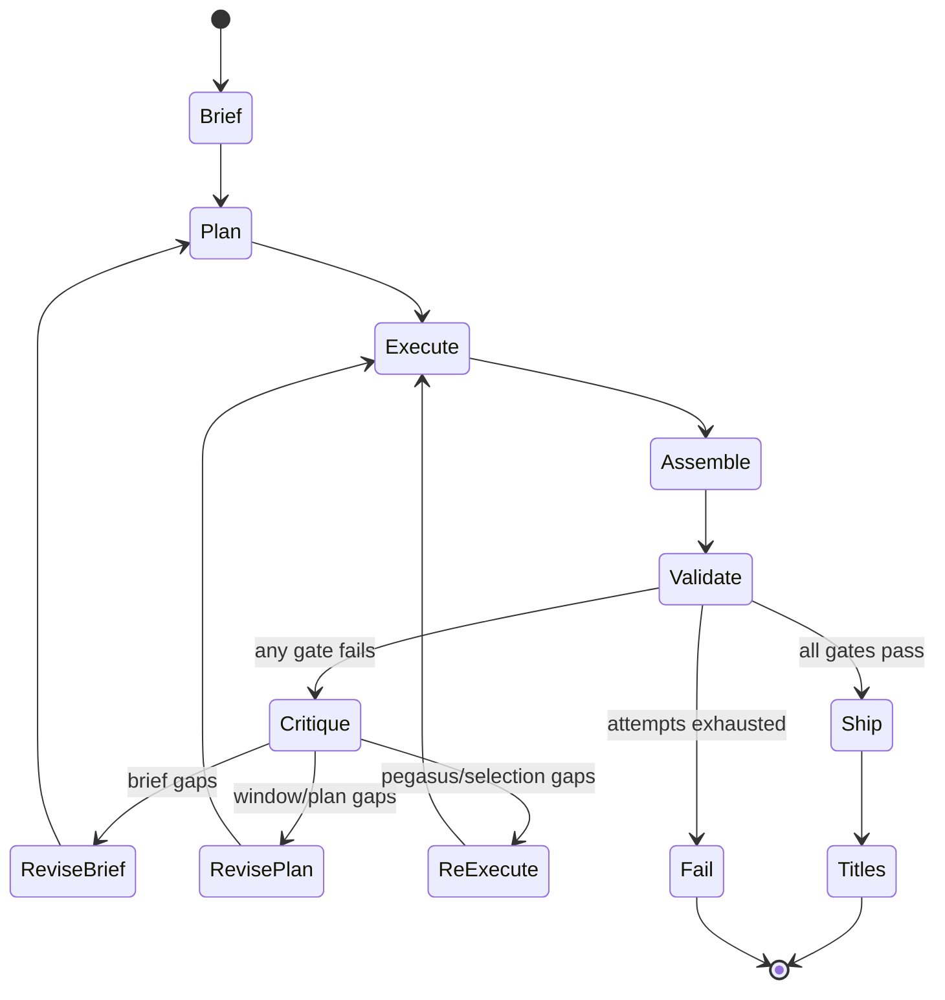

# Jockey v2 — Loop Until Right

**Status:** Draft — direction for post-launch iteration  
**Supersedes (partially):** `SPEC-jockey-product-ux.md` §2 post-process steps, `SPEC-jockey-compact-recap.md` Phase 4 trim logic  
**Companion:** `SPEC-jockey-product-ux.md` (deploy/rollback, UX, defaults), `backend/EVAL-SUITE.md`  
**Motivation:** Production compact on a ~57 min Sopranos episode (July 2026) proved Jockey fixes timeline bias, but **deterministic post-processing** (`selectSegmentsForTarget`, enforcer splits/drops, quartile backfill, recap window narrowing) produced confusing output — e.g. one 600s Pegasus blob per window, enforcer split into `(Part N)` fragments, then title pass tried to paper over it.

---

## 1. Problem statement

### What v1 Jockey does today

```
Brief (Claude) → windowed Pegasus → merge → keep filter
  → selectSegmentsForTarget (drop segments to hit duration)
  → backfillQuartileCoverage (add segments back for coverage)
  → enforceConstraints (split oversized, drop to target, resolve overlaps)
  → applyNarrativeTitles
```

This is a **one-shot pipeline with deterministic repair**. Repairs optimize **metrics** (duration band, quartile counts, beat count) not **watchability**.

### Why that fails producers

| Symptom | Root cause |
|---------|------------|
| `(Part N)` or duplicate-feeling cuts | `splitOversizedSegments` in `verify.ts` mechanically chops blobs |
| Segments that “don’t make sense” next to each other | `selectSegmentsForTarget` drops by score, not narrative continuity |
| Recap beats that feel arbitrary | `narrowRecapBeatWindows` shrinks time ranges without re-selecting story |
| Timeline looks covered but content is thin | `backfillQuartileCoverage` adds any candidate in an empty quartile |
| One giant segment per window | Pegasus prompt/window sizing wrong; enforcer “fixes” instead of re-asking Pegasus |

**Product rule:** If output doesn’t meet goals, **loop and revise** — don’t silently reshape timestamps in code.

### What v1 got right (keep)

- Claude **NarrativeBrief** grounded in transcript + producer instructions
- **Virtual windowing** on long sources (org TwelveLabs key)
- **Coverage validation** as a gate (fail loud, retry with smaller windows)
- **Feature flag** rollback to legacy Pegasus
- **No Gemini** for preprocess; Bedrock + Anthropic fallback
- **50% compact default**; recap 4–6 beats / ~60–90s

---

## 2. North star

> **Jockey loops until it produces tight, engaging segments a producer would actually ship — or it fails with a clear error.**

**Tight** = each segment is a coherent dramatic unit (not a arbitrary time slice), respects per-segment bounds, and the **total runtime** lands in the target band without mechanical trimming.

**Engaging** = selections advance story, favor dialog-forward moments, honor producer themes, and (for recap) read as a connected mini-narrative.

**Loop until right** = critique → structured revision → re-execute (bounded attempts), not deterministic enforcer hacks.

---

## 3. Principles

1. **No deterministic creative editing.** Code may validate, score, and route; it may **not** split, drop, merge, or resize segments to hit duration/beat targets.
2. **Validators gate; agents revise.** Failed validation returns structured feedback to the next loop iteration.
3. **Transcript is source of truth.** Timestamps come from ASR boundaries; agents select from verified ranges, never invent times.
4. **Small focused loops.** Each iteration has one job (plan windows, run Pegasus, critique assembly, refine brief, etc.).
5. **Fail loud.** After max attempts, job `failed` with actionable error — no heuristic fallback when Jockey flag is on.
6. **Same output contract.** `ProposedSegment[]` unchanged for editor/export.

### Allowed deterministic operations (safety only)

| Allowed | Forbidden |
|---------|-----------|
| Clamp segment times to `[0, videoDuration]` | Split segment because `duration > 180s` |
| Reject overlapping segments (fail validation) | Auto-split overlaps at midpoint |
| Merge duplicate Pegasus rows (>50% overlap dedup) | Drop lowest-score segment to hit target % |
| Snap boundaries to nearest **scene break / transcript word end** (see §14) | `narrowRecapBeatWindows` without agent |
| Poll/retry Pegasus tasks; halve window size on coverage fail | `backfillQuartileCoverage` |

> **Boundary snapping is the one deterministic edit we explicitly *want*.** It only moves an existing cut to a nearby natural break (scene change or sentence end); it never adds, drops, splits, or reorders segments. See §14.

---

## 4. Goals & acceptance criteria

### Compact (`compact_video`)

| Criterion | Measurement |
|-----------|-------------|
| **Timeline spread** | ≥1 segment midpoint in each quartile (sources >45 min) |
| **Target runtime** | Total duration ∈ **[45%, 55%]** of source (default center 50%) |
| **Segment bounds** | Each segment ∈ **[60s, 180s]** unless producer overrides via API |
| **Coherence** | Critique agent: no segment is “unwatchable in isolation” (binary per segment) |
| **Clean cut points** | Every segment start/end within **±0.75s** of a detected scene break or sentence boundary — no mid-scene spill (see §14) |
| **No mechanical titles** | No `(Part N)`; titles from beat labels or transcript |
| **Producer themes** | Named instructions reflected in ≥1 segment title/reasoning when provided |

### Ep Recap (`episode_recap`)

| Criterion | Measurement |
|-----------|-------------|
| **Beat count** | 4–6 segments |
| **Total duration** | 60–90s |
| **Segment bounds** | 10–20s per beat (prompt-level; no post-hoc narrowing) |
| **Narrative flow** | Critique: ordered beats form setup→payoff chain |
| **Connected** | Each beat’s reasoning references prior beat role |
| **Clean cut points** | Each beat starts/ends on a scene break or sentence boundary — never mid-line (see §14) |

### Universal

- **Zero enforcer-driven segment count changes** for duration targeting.
- **Max loop attempts:** 3 full critique cycles (configurable); then `failed`.
- **Partial Pegasus window failure:** retry failed windows once; if still failing, loop may replan windows — do not ship with <5/7 windows on >45 min compact without passing coverage.

---

## 5. Target architecture



### Phase A — Brief (existing, extend)

**Input:** transcript, `userPrompt`, title, duration, purpose, target runtime  
**Output:** `NarrativeBrief` + **`EditorialPlan`**

`EditorialPlan` (new):

```typescript
interface EditorialPlan {
  /** Ordered candidate moments to seek — not final segments */
  candidates: Array<{
    beatId: string;
    label: string;
    startSec: number;  // transcript-grounded
    endSec: number;
    priority: "must" | "should" | "could";
    maxSegmentSec: number;  // agent-chosen cap ≤ 180
  }>;
  /** How many segments we expect to ship */
  targetSegmentCount: { min: number; max: number };
  targetTotalSec: number;
  /** Windows Pegasus should analyze (may differ from dumb 10min grid) */
  analysisWindows?: AnalysisWindow[];
}
```

Brief + plan produced in **one Claude call** initially; revised on critique in later loops.

### Phase B — Execute (Pegasus)

- Run Pegasus per `EditorialPlan` window (or planner output).
- Segment definitions reference **specific candidate beats** in that window, with explicit “return 2–5 segments, each 60–180s” (compact) or “return exactly the recap beats marked must” (recap).
- **Reject** window results where any row exceeds `maxSegmentSec` — do not split; send to critique as `oversized_blob`.

### Phase C — Assemble

- Merge window rows; dedupe overlaps only.
- Map rows → `ProposedSegment[]` with transcript snippets.
- **No** `selectSegmentsForTarget`, **no** `enforceTotalDuration`, **no** `backfillQuartileCoverage`.

### Phase D — Validate (deterministic gates only)

`validateJockeyOutput(segments, duration, purpose, plan)` → `{ passed, issues: ValidationIssue[] }`

Issues are **typed** for routing:

| Issue type | Routes to |
|------------|-----------|
| `timeline_coverage` | RevisePlan (smaller windows / more windows) |
| `duration_over` / `duration_under` | ReExecute with “drop optional candidates” or “add must candidates” |
| `segment_too_long` / `segment_too_short` | ReExecute affected windows |
| `beat_count` | ReviseBrief (recap) |
| `narrative_incoherent` | Critique → ReviseBrief |

### Phase E — Critique (Claude)

**Input:** segments, brief, plan, validation issues, transcript excerpts per segment  
**Output:** `CritiqueResult`

```typescript
interface CritiqueResult {
  watchabilityScore: number;  // 0-1
  segmentNotes: Array<{ index: number; keep: boolean; issue: string }>;
  planRevisions?: Partial<EditorialPlan>;
  briefRevisions?: Partial<NarrativeBrief>;
  /** Natural-language instructions for next Pegasus pass */
  pegasusGuidance?: string;
}
```

Critique runs **only when** validation fails OR watchability < threshold (e.g. 0.75).

### Phase F — Titles (unchanged)

`applyNarrativeTitles` after **Ship** — cosmetic metadata only, never changes `startTime`/`endTime`.

---

## 6. Loop control

```typescript
interface JockeyLoopState {
  attempt: number;
  maxAttempts: 3;
  brief: NarrativeBrief;
  plan: EditorialPlan;
  segments: ProposedSegment[];
  history: Array<{ attempt: number; issues: string[]; action: string }>;
}
```

**Loop exit:**

- All validators pass AND `watchabilityScore ≥ 0.75` → Ship
- `attempt >= maxAttempts` → throw with full `history` in job error

**Retry strategies (in order):**

1. **ReExecute** — same plan, tightened Pegasus prompts from critique (cheapest)
2. **RevisePlan** — adjust windows / candidate priorities
3. **ReviseBrief** — re-run brief+plan with critique context (expensive; max 1× per job)

**Not a retry strategy:** enforcer split/drop/trim.

---

## 7. Pegasus contract changes

Today Pegasus often returns **one row per window** spanning the entire window. v2 must treat that as **failure**, not input to enforcer.

### Compact window prompt requirements

- “Return **multiple** segments per window when material warrants it.”
- “Each segment **60–180 seconds**. If a story beat is longer, end at the strongest natural break and continue in the next segment.”
- “Mark segments with `microseries_keep: yes` only for must/should candidates.”

### Recap prompt requirements

- “Return **4–6** segments total across the full video, each **10–20 seconds**.”
- “Each segment = one recap beat; do not return full scenes.”

### API constraint (already discovered)

`time_ranges` on segment definitions **cannot** combine with `min_segment_duration` / `max_segment_duration`. Duration bounds must live in **prompt text** until TwelveLabs changes API — validators enforce, loop re-asks.

---

## 8. What to remove from Jockey path

Remove or bypass for `JOCKEY_COMPACT_RECAP_ENABLED` jobs:

| Module | Function | Action |
|--------|----------|--------|
| `jockey-pipeline.ts` | `selectSegmentsForTarget` usage | **Remove** |
| `jockey-pipeline.ts` | `backfillQuartileCoverage` | **Remove** |
| `jockey-pipeline.ts` | `fitRecapBand` / `narrowRecapBeatWindows` | **Remove** |
| `jockey-pipeline.ts` | `enforceConstraints` (duration split/drop) | **Remove** — keep clamp-only helper if needed |
| `verify.ts` | `splitOversizedSegments`, `enforceTotalDuration`, `dropOneSegment` | **Not called from Jockey** |
| `jockey-pipeline.ts` | `segmentsFromRecapBeats` fallback | **Replace** with loop ReviseBrief |

Legacy Pegasus path (`JOCKEY_COMPACT_RECAP_ENABLED=false`) may keep existing behavior for rollback.

---

## 9. Observability

Log per attempt:

```
[Jockey] attempt 2/3 action=ReExecute issues=duration_over:2340s>1719s,segment_too_long:3
[Jockey] critique watchability=0.62 dropped_candidates=[beat-7]
[Jockey] attempt 3/3 action=Ship segments=14 total=1698s quartiles=3/4/4/3
```

Store in `generationJob` metadata (P2): `jockeyAttempts`, `lastCritique`, `validationIssues` — helps producers understand failures.

---

## 10. Migration plan

### M1 — Stop the bleeding (1–2 days)

- [ ] Feature flag `JOCKEY_V2_LOOP_ENABLED` (default `false`)
- [ ] Remove enforcer + selection from v1 Jockey path behind flag OR document as known debt
- [ ] Fail job when any segment >180s post-Pegasus (no split) — forces awareness

### M2 — Validation + critique loop (1 week)

- [ ] `EditorialPlan` type + brief prompt update
- [ ] `validateJockeyOutput` with typed issues
- [ ] `critiqueAssembly` Claude call
- [ ] Loop orchestrator in `jockey-pipeline.ts` (or `jockey/loop.ts`)
- [ ] Eval suite: add `acceptance_no_enforcer` profile

### M3 — Pegasus prompt + window replanning (1 week)

- [ ] Beat-scoped window planner (not fixed 10min grid only)
- [ ] ReExecute path with critique-guided prompts
- [ ] **Scene-boundary snapping** (§14): `snapToBoundaries` helper reading S3 `scene-cache` + transcript, called before titles
- [ ] Fix recap so windowed Pegasus produces beats (stop relying on brief fallback)
- [ ] Re-run Philadelphia + Murdoch + production Sopranos asset

### M4 — Ship v2 (2 days)

- [ ] `JOCKEY_V2_LOOP_ENABLED=true` in prod
- [ ] Monitor watchability / failure rate
- [ ] Deprecate v1 one-shot path

---

## 11. Eval additions

Extend `backend/EVAL-SUITE.md`:

| Check | Pass condition |
|-------|----------------|
| `no_oversized_segments` | All segments ≤180s (compact) or ≤20s (recap) |
| `no_enforcer_artifacts` | No title matching `(Part \d+)` or dedup `(\d+)` suffix |
| `no_midscene_spill` | All segment edges within ±0.75s of a scene break / sentence end when scene cache present (§14) |
| `duration_band` | Compact 45–55%; recap 60–90s |
| `timeline_coverage` | Existing quartile checks |
| `recap_from_pegasus` | Recap beats sourced from windowed Pegasus, not brief fallback |
| `loop_efficiency` | ≤3 attempts median on eval assets |

Add eval approach: `jockey-v2-loop` (production path target).

---

## 12. Production incident notes (July 2026)

**Job:** `f78f5232-f60b-432e-937f-05ac0673ca36` — compact, ~3439s source, 12 segments ~1844s.

**Evidence Jockey helped:** windows 0–5 covered 0–3300s; would not happen on baseline Pegasus.

**Evidence v1 debt:** 1 segment per window from Pegasus; enforcer split 5→19, dropped 7; Bedrock throttled to Anthropic API.

**v2 would have:** failed validation on `segment_too_long`, loop ReExecute with “return multiple shorter segments per window,” not shipped enforcer output.

---

## 13. Round-2 overnight eval (July 2 2026)

Full suite re-run on the two reference assets via `jockey:eval:suite` (production path = `jockey-gemini-full`: Claude Sonnet brief + windowed Pegasus).

### Compact — Law & Disorder in Philadelphia (3527s, target ~1764s)

| Metric | Result |
|--------|--------|
| Acceptance | **✓ pass** |
| Segments shipped | 13 |
| Output duration | 1896s (~54%) |
| Quartile midpoints | 4 / 4 / 3 / 2 — first-half healthy |
| Latter-50% ratio | 38% |
| Wall time | 275s |

**Headline:** timeline-bias fix holds — segments now populate Q1/Q2, the exact defect JT flagged June 2 (“Compact pulls only from the 2nd half, omitting the first segments”). This is the win to record.

**But the run log exposes the v1 debt, and it maps directly to the cut-quality complaint:**

```
Total available: 3887s from 7 segments      ← Pegasus returned ~1 blob per window
After trimming: 3 segments (1487s)          ← selectSegmentsForTarget gutted it
Quartile backfill: 3 → 5 segments           ← metric-driven re-add
Enforcer: Split 13 oversized segment(s) >180s; Dropped 5 to meet target
```

- The shipped boundaries are **arbitrary**: `…→304`, `…→600`, `1080→…`, `2160→…`, `→2589`, `→2730`. These are **enforcer split points at 180s intervals and 10-min window edges**, not story/scene ends. That is precisely the “cuts at weird locations that spill into the next scene” symptom.
- Two adjacent pairs shipped as `…shooter` / `…shooter (2)` and `…threats` / `…threats (2)` — the dedup `(N)` suffix in `titles.ts` papering over a mechanical split. Still an artifact even though it isn’t literally `(Part N)`.

### Recap — Murdoch Mysteries 101 (2884s, target ~75s)

| Metric | Result |
|--------|--------|
| Acceptance | **✓ pass** |
| Beats | 5 |
| Duration | 70s |
| Wall time | 150s |

**But:** run log says `Only 0 recap beats survived — rebuilding from Claude brief recapBeats`. **Pegasus contributed nothing** to the recap; the entire output came from the Claude-brief fallback (`segmentsFromRecapBeats`). We are “passing” recap on the fallback path, not the intended windowed-Pegasus path. Beat time-ranges therefore come straight from Claude’s approximate transcript timestamps — another source of imprecise cuts.

### Net read

> The pipeline is **“fine” at the coverage/duration level and genuinely fixes the historical bias**, but it hits its acceptance numbers through mechanical repair (split/drop/backfill/fallback) rather than through good editorial cuts. Every remaining “feels off” symptom traces to the deterministic post-processing the v2 loop already targets — plus one new gap: **nothing snaps cuts to scene boundaries** (§14).

---

## 14. Scene-boundary alignment (new requirement)

**Motivation (this round):** producer feedback — *“some cuts appear at weird locations; they spill into the next scene rather than cutting at the end of the scene.”* Confirmed in code: the Jockey path has **no scene-boundary awareness at all**. Cut points come from (1) raw Pegasus rows, (2) enforcer splits at fixed 180s intervals, or (3) Claude brief approximate timestamps — none aligned to visual scene changes.

**Contrast with what Jockey/12L can do:** Scott’s direct Agents-API experiments (Slack, June) returned segments on natural, non-round boundaries (e.g. `147.04→272.04`, `265→302`) with “healthy cuts throughout.” We are degrading that by re-cutting downstream.

### Requirement

Every shipped segment `startTime`/`endTime` must land on the **nearest natural break** within a small tolerance, in priority order:

1. **Visual scene break** — from the existing scene-detection Lambda / S3 `scene-cache` (`SceneBreak`, `zeevee-detect-scenes`). Prefer cutting on a shot/scene change.
2. **Sentence boundary** — nearest transcript segment end (ASR word end) when no scene break is within tolerance.
3. **Leave as-is** — if neither is within tolerance, keep Pegasus’ point (do not force a bad snap).

### Rules

- **Snap only** — moves an existing cut ≤ a few seconds to a real break. It must **never** add, drop, split, merge, or reorder segments, and must not push total duration outside the band.
- **Refine, don’t generate** — this is the one deterministic edit v2 keeps (§3). It runs *after* Assemble/Ship, *before* Titles.
- **Prefer ending on scene-out** — when a segment’s content ends mid-scene, extend/trim to the scene boundary that best contains the beat; bias toward the *end* of the current scene rather than bleeding into the next.
- **Recap beats** — snap the 10–20s window to the scene containing the beat’s peak so beats don’t open/close mid-line.

### Where it plugs in

- Scene breaks are already produced by `zeevee-detect-scenes` and cached in S3 (`s3://zeevee-assets/scene-cache/`). Jockey currently ignores them.
- New helper (proposed): `snapToBoundaries(segments, sceneBreaks, transcript, tolerance)` in `jockey/boundaries.ts`, called from `jockey-pipeline.ts` right before `applyNarrativeTitles`.
- Scene cache is **optional / never auto-triggers detection** (per StoryIQ Phase 2). When the cache is absent, fall back to sentence-boundary snapping only — do not block generation on scene detection.

### Acceptance

- `no_midscene_spill` eval check: 100% of segment edges within ±0.75s of a scene break or sentence end (when scene cache present).
- Visual spot-check: cuts land on shot changes, not mid-gesture / mid-word.

---

## 15. Getting full value from Jockey (Agents API gap)

The user’s question — *“where is it falling short from getting full value out of Jockey?”* — is really about `Jockey-docs.md`, which documents the **TwelveLabs Agents API** (`jockey1.0`): knowledge stores + the Responses API, with cross-video reasoning, entity tracking, and multi-step editorial output.

**What production actually runs today is *not* that.** Our “Jockey” is a local TypeScript re-implementation: Claude Sonnet writes a brief, then plain Pegasus `time_based_metadata` segments per window. We have `jockey-agents-api.ts` + `preprocess-agents.ts`, but they’re **eval-only** (`agents-brief-*` approaches); the shipped path never calls the Agents API for anything but a brief experiment.

### Value we’re leaving on the table

| Capability in Jockey-docs / Scott’s experiments | Production status | Gap |
|---|---|---|
| **Agentic editorial cut selection** (“you are a film editor… tightly edited highlight following the narrative arc”) returning clean, scene-aligned cuts directly | Not used — we substitute Pegasus + enforcer | The mechanical-split problem is *self-inflicted*; the Agents API already returns good boundaries |
| **Dialog-forward selection** (“focus on scenes with dialog that advances character/story”) | Only as brief text, not enforced | Scott’s prompt-#3 insight (“audience needs dialog”) isn’t a first-class selection criterion |
| **One-pass metadata** — per-scene name, ≤10-word description, mood/theme/tone/content-advisory/**IAB taxonomy 3.0** | Done separately in export-metadata pipeline | Duplicated work; Jockey could emit it inline (Scott’s “Qlio Standard Metadata Prompt”) |
| **Thumbnails / poster art** (square, dramatic-face framing, timestamped filenames) | Not produced by generation | JT + Scott both asked for this (“thumbnail tool”, “enable thumbnails and poster art”) |
| **Entity extraction / tracking** across the knowledge store | Unused | Character-aware recaps and “instant-replays-only”-style use-cases |
| **Iterative refinement in-agent** (Scott ran prompt #1→#3 to converge) | We do a fixed one-shot | This is exactly what the v2 critique loop (§5) re-creates locally |

### Recommendation

Two tracks, not mutually exclusive:

1. **Short term (v2 loop, §5):** keep the local orchestration but (a) fix the cut quality via the loop + scene-boundary snapping (§14), and (b) promote dialog-forward + producer-beat selection to hard critique criteria. This removes the worst symptoms without an API dependency.
2. **Evaluate Agents-API-native path:** run a head-to-head on the reference assets between `jockey-v2-loop` and `agents-segments-direct` / `agents-brief-pegasus`. If the hosted Agents API returns scene-aligned, dialog-forward cuts *and* inline metadata/thumbnails as reliably as Scott’s manual runs suggest, a large slice of our post-processing (and the whole enforcer) becomes unnecessary. Decision gate: cut quality + latency + cost + beta-stability.

> **Framing for the team:** v1 proved we can beat baseline Pegasus on *coverage*. The gap to “full value” is **cut craft + downstream artifacts (metadata/thumbnails)** — both of which the Agents API and Scott’s prompts already demonstrate. v2 should either match that locally (loop + boundary snap) or adopt it directly.

---

## 16. Open questions

1. **Bedrock quota** — request limit increase vs. default to Anthropic API for brief+critique?
2. **Critique cost** — run every attempt or only on validation failure?
3. **Producer-in-the-loop** — future: show critique summary in IQ Editor before finalize?
4. **TwelveLabs** — escalate `time_ranges` + duration bounds API limitation?
5. **Scene cache coverage (§14)** — do all target assets have a populated `scene-cache`? What’s the sentence-only-snap fallback quality when they don’t?
6. **Agents API vs local (§15)** — do we invest further in the local loop, or pivot the shipped path to `agents-segments-direct` if the head-to-head favors it?
7. **Content-kind routing** — JT’s “future state” (Documentary / Procedural / Comedy change the prompt) conflicts with the current “Asset Type is metadata-only” rule. Revisit whether content-kind should drive brief/critique prompts.

---

## 17. Decision log

| Decision | Choice | Rationale |
|----------|--------|-----------|
| Duration targeting | **Agent loop**, not enforcer | Mechanical trim confuses producers |
| Oversized Pegasus blobs | **Re-execute**, not split | Splits create `(Part N)` garbage |
| Coverage gaps | **Replan windows**, not backfill | Backfill optimizes metrics not story |
| Cut boundaries | **Snap to scene breaks / sentence ends** (§14) | Overnight run shipped arbitrary 180s/window-edge cuts that spill into the next scene |
| Recap source of truth | **Fix windowed Pegasus**, don’t rely on brief fallback | July 2 recap passed only via `segmentsFromRecapBeats` fallback (0 Pegasus beats) |
| Agents API | **Bench head-to-head, don’t assume** (§15) | Scott’s manual runs show it may obsolete our post-processing; verify before committing |
| v1 flag | Keep `JOCKEY_COMPACT_RECAP_ENABLED` | Rollback; add `JOCKEY_V2_LOOP_ENABLED` for new behavior |
| Output contract | Unchanged | Editor/export stability |

---

## Appendix: file map (v2)

| Area | Path |
|------|------|
| Loop orchestrator | `backend/src/services/storyiq/jockey/loop.ts` (new) |
| Validation gates | `backend/src/services/storyiq/jockey/validate.ts` (new) |
| Critique agent | `backend/src/services/storyiq/jockey/critique.ts` (new) |
| Scene/sentence boundary snap (§14) | `backend/src/services/storyiq/jockey/boundaries.ts` (new) |
| Scene detection source | `zeevee-detect-scenes` Lambda + `s3://zeevee-assets/scene-cache/` |
| Agents API client (§15, eval today) | `backend/src/services/jockey-agents-api.ts`, `jockey/preprocess-agents.ts` |
| Editorial plan types | `backend/src/services/storyiq/jockey/types.ts` |
| Brief prompts | `backend/src/services/storyiq/jockey/prompts.ts` |
| Titles (metadata only) | `backend/src/services/storyiq/jockey/titles.ts` |
| Entry | `backend/src/services/storyiq/jockey-pipeline.ts` |
| Eval | `backend/src/scripts/jockey-eval-suite/` |
