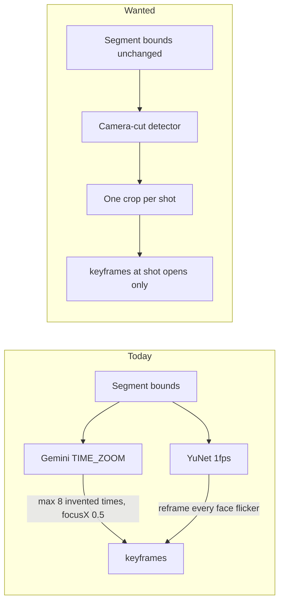

# SPEC — Shot-hold framing (problem model)

Status: **Problem model only. Do not implement from this doc.**
Owner: TBD
Related: [SPEC-iq-agent.md](SPEC-iq-agent.md), [backend/src/handlers/analyzeFraming.ts](backend/src/handlers/analyzeFraming.ts), [zeevee/src/lib/zoomMath.ts](zeevee/src/lib/zoomMath.ts)

This document states the framing problem. It does not pick an algorithm, a model, or a ship plan.

When this work is kicked off, **model how to build and test the systems first** — layered (clock vs crop vs job), with gold that is camera cuts not the 351 Nashville framing holds, and with prove-gates per layer. Do not jump to a production path.

---

## 1. What this is

A **segment** is an editorial choice: which stretch of the source belongs in the cut. That work is already owned by the IQ agent (`edit_segments`, visual edge verification, auto-framing kickoff after `finish_turn`).

This problem is **not** that.

Inside a finished segment, the 16:9 source still has **camera cuts** (shot changes). Each shot needs its own 9:16 crop: a zoom and a left/right pan, held for the life of that shot.

Lionsgate’s note on the Nashville cut: the framing track is **too choppy**. They want fewer reframes and a smoother hold inside a shot — not denser keyframes, and not a re-cut of the episode into different segments.

The job:

1. Leave `startTime` / `endTime` alone.
2. Find every camera cut that falls inside those bounds.
3. Write one framing hold per shot: prefer a true 9:16 fill, shift left/right to keep the subject in frame, zoom out slightly only when 9:16 would clip what matters.

---

## 2. What this is not

| Not this | Why people mix it up |
|---|---|
| IQ / Jockey **segment** generation | That chooses *which* parts of the episode to keep. Framing does not add, remove, or retimecode segments. |
| TwelveLabs `zeevee-detect-scenes` / `scene-cache` | Orphaned narrative scene list. Unused by current generation. Wrong granularity and wrong job. |
| Nashville’s 26-part Lionsgate EDL | Editorial scene list. The “highly cut-up” feel is mostly the **framing keyframe** track inside those parts (351 holds, 41 in the first scene alone). |
| Per-frame or 1 fps reframing | YuNet-style chatter. Smoothness dies. |
| Asking a VLM for `TIME\|ZOOM` lines | Current Gemini path. The model invents timestamps. Density is capped at 8, so it cannot express a 40-shot scene and still jitters inside a shot. |

If a change would move a segment edge, it is out of scope.

---

## 3. Evidence we already have

Measured 18 Sep 2026 against **Lionsgate Cut 081926** (`dc1a5723-…`, asset `64b4881a-…`). Gold = stored keyframes, sampled at 1 fps over 2,315 framed seconds.

| Signal | Number | Meaning |
|---|---:|---|
| Gold framing keyframes | 351 | Human-dense on early scenes; 8 scenes marked Gemini |
| Gold interior framing cuts | 308 | A cut = zoom or pan change, not a segment edge |
| YuNet zoom agree vs gold | 41.9% | Fails the old 85% prove-gate |
| YuNet cut recall / precision / F1 | 94.8% / 20.8% / 0.34 | Hits almost every gold cut, then adds 4.6× extras (1,407 vs 308) |
| Faces inside YuNet crop | 100% | By construction: it widens until every detected face fits |
| Faces inside gold crop | ~49% | Nashville is a **speaker** crop, not an all-faces crop |
| Gemini-stored scenes, zoom agree | 37.2% | Cheap cropper does not match Gemini either |
| Gold zoom mix (by time) | 62% TIGHT | Punch-in is the default artistic choice today |
| `focusX` range | 0.0–1.0 (mean 0.53) | Pan is real. `focusY` is ~0.5; vertical is not the problem |
| Production Gemini cap | 8 keyframes / clip | Cannot represent a 40-hold scene; still asks the model for times |

Closest gold match was *Who Was the Genius?* (80% zoom, 0.76 cut F1). Gemini-capped scenes with 2–5 keyframes were the worst: the cropper still emitted 30–70 cuts.

Scorecard: [nashville-yunet-bakeoff.canvas.tsx](/Users/cisner/.cursor/projects/Users-cisner-Documents-Coding-Work-consulting-zeevee-zeevee/canvases/nashville-yunet-bakeoff.canvas.tsx).

The August SporeLabs reframe PoC (`feat/reframe-experiment`, never merged) treated this as a per-frame classifier. That is the opposite of “less choppy.”

---

## 4. The actual outputs

Persisted shape does not change. A segment already stores [FramingKeyframe](zeevee/src/remotion/types.ts): `time` (seconds from segment start), `focusX`, `focusY`, `zoom` in `[0, 1]`. Preview and export already resolve those on the integer source-frame grid (PRs #87–#91). Hard contract: old framing through frame `N−1`, new framing on frame `N`. No interpolation across a cut.

What we are missing is a **rule for when `N` is allowed to exist**.

```
segment [startTime, endTime)          ← editorial, already decided
  shot 0  [start, cut1)   → one keyframe at shot open
  shot 1  [cut1, cut2)    → one keyframe at cut1
  shot 2  [cut2, end)     → one keyframe at cut2
```

A shot hold is constant. Motion inside a shot is absorbed by a slightly wider crop, not by a new keyframe. A new keyframe is allowed only at a camera cut (or a later, explicit “subject left the crop” exception — not in v1 of the problem statement).

`zoom` today is continuous. The Gemini mapper snaps to four tokens ([analyzeFraming.ts](backend/src/handlers/analyzeFraming.ts) `ZOOM_LEVEL_MAP`: TIGHT 1.0, MEDIUM 0.5, WIDE 0.25, FULL 0.0). The editor can store any value. The problem statement’s “keep it 9:16 when we can, zoom out slightly” is a **policy on that number**, not a new schema:

- **9:16 fill** = TIGHT (`zoom = 1`) on a 16:9 source in a 9:16 canvas. That is the default.
- **Pan** = `focusX` in `[0, 1]`. This is how we keep a subject centered without changing zoom.
- **Zoom out slightly** = drop toward MEDIUM / WIDE only when the 9:16 slice clips the subject. FULL (letterbox) is a last resort, not a no-face fallback.

`focusX = 0.5` hardcoded in Gemini is part of the problem. Pan is half the job.

---

## 5. Camera cuts are not encoder keyframes

A cheap first instinct is: “FFmpeg the GOP I-frames; those are the cuts.”

They are not.

| Event | What it is | Relation to a camera cut |
|---|---|---|
| **I-frame / IDR** | Encoder refresh for seeking and GOP length | Often *near* a cut if `scenecut` was on, but also every N seconds mid-shot. A locked GOP will miss cuts. |
| **Camera cut / shot change** | The picture actually changes: new angle, new setup | What Lionsgate’s framing should hang on |
| **Editorial segment edge** | Producer / IQ agent in/out | Already decided. Framing must snap *to* these, not move them |

I-frames are a **noisy, encoder-dependent proxy**. They can be a hint, not the source of truth.

The detector we have not chosen yet must output **source-timeline timestamps** (or integer source frames) that mean “the picture changed,” independent of GOP. FFmpeg’s `scene` filter, a decoded-frame difference, or a dedicated shot library are candidates. This doc does not pick one. Whatever we pick has to be:

- **Cheap** — one decode pass (or better), not a VLM per second
- **Stable** — same file → same cuts
- **Tunable** — a threshold we own, because “less choppy” is a density knob after detection, not a prompt
- **Grounded** — times come from pixels, never from a model writing clocks

---

## 6. Why current systems fail this job



**Gemini (`analyzeFraming`)** after IQ `finish_turn` ([loop.ts](backend/src/services/iq-agent/loop.ts) `autoFrame`): FFmpeg-cuts the segment, uploads it, asks `gemini-2.5-pro` for up to 8 `TIME|ZOOM` lines. The model is paid to invent times. Pan is unused. Density is both too low for a long multi-shot scene and too free inside a single shot.

**YuNet PoC**: correct impulse (faces → crop geometry) on the wrong clock (every sampled frame). High recall of *when* Nashville moved, terrible precision. All-faces coverage fights speaker-centric 9:16.

**IQ agent tools** (`view_frames`, `watch_clip`): built so Claude can **verify an editorial edge**, not so it can place 300 framing holds. If the agent starts calling vision tools to pick `focusX` per shot, we will be slow, expensive, and ungrounded again.

**TwelveLabs scene cache**: narrative who/action/mood rows. Not shot boundaries.

---

## 7. The smoothness constraint

“Less choppy, more smooth” is a **hold policy**, not a dissolve.

- Across a camera cut, a hard switch is correct. That is how the source is cut. Preview/export already do `N−1` / `N` with no in-between frame.
- Inside a shot, the crop must not walk. No 1 fps zoom chatter. No “subject leaned two inches, punch in.”
- If the subject walks toward the edge, v1 still holds and **zooms out slightly** at shot open so the walk stays inside. Continuous tracking is a later problem (and a choppiness risk).
- Density target is on the order of **shots in the footage**, not keyframes-per-minute and not “max 8.” A 186s scene with 12 camera cuts should get ~12 holds, not 41 (Nashville human) and not 128 (YuNet).

Lionsgate is asking us to **under-cut** the current Nashville framing track, not to match it.

---

## 8. Framing policy (the decision, once the cut is known)

For each shot, choose one `(zoom, focusX)`:

1. Default to the 9:16 cover window (`zoom = 1`).
2. Place that window with `focusX` so the subject is centered in the crop — not so the crop is centered on the frame.
3. If the subject (or the set of subjects we decide to keep) does not fit, reduce zoom just enough. Do not jump to FULL because a detector saw zero faces.
4. `focusY` stays 0.5 until someone proves we need vertical punch on this show.

Open product choice, not decided here: **whose** face/body counts as the subject (speaker, largest face, all faces, on-axis talent). Nashville gold implies speaker. An all-faces objective will systematically zoom out and look “safer” and less like the show.

---

## 9. How an agent should sit in this (cheap, fast, correct)

Own the control flow. The LLM does not get a clock.

```
prompt → parse → switch → execute → loop
```

applies to **editorial cutting**. Framing is the `execute` after the cut is committed — the same shape as delivery metadata today ([metadata.ts](backend/src/services/iq-agent/metadata.ts): “skip — the same shape as autoframing”).

| Role | Does | Does not |
|---|---|---|
| **Software job** | Detect shot bounds from pixels; pick `(zoom, focusX)` with a cheap, deterministic scorer; write keyframes on the frame grid | Ask Claude/Gemini for timestamps |
| **IQ agent** | Trigger the job on unframed segments; tell the producer “12 shots, 12 holds”; leave a note if the job failed | Place or revise individual shot times in prose |
| **Producer** | Nudge a hold in the existing keyframe UI (“Add cut here” / move) | Wait for a VLM to re-watch the hour |
| **LLM (optional, later)** | Classify *which* person is the subject from a still, as JSON | Emit `TIME\|ZOOM` |

Cost model we are optimizing for:

- **Decode once** per segment (or per asset, cached).
- **Detect faces / subjects on a handful of samples per shot** (open, mid, close — or one), not on every frame.
- **No File-API upload of the whole clip to Gemini** as the happy path.
- **No Pegasus `watch_clip` per shot.**

A later agent loop that “frames the project” by calling `view_frames` in a circle is a regression: slow, metered by video-seconds and tokens, and it reintroduces invented times.

Statelessness: shot lists and keyframes live on the project / S3, not in the model context. The job must be restartable (same as today’s `framingJob` row).

---

## 10. Acceptance picture (when someone implements this)

A solution is right if all of these are true:

1. Segment in/out times are byte-identical unless the producer edited them.
2. New AI keyframes appear only at detected camera cuts (plus t=0 of the segment).
3. Hold count ≈ camera-cut count, not ≈ seconds and not a hardcoded 8.
4. Default crop is 9:16; pan is used before zoom-out; FULL is rare.
5. Lionsgate-style “choppy” means we can raise the *minimum hold* or the *cut threshold* without retraining a model.
6. Preview and export still obey the integer frame contract.
7. Dollars and wall time stay on the decode + cheap vision side, not on a per-shot VLM.

A solution is wrong if Claude or Gemini is the thing that decides *when* the crop changes.

---

## 11. Open questions (for the implementation kickoff)

1. **Subject:** speaker vs largest face vs all faces vs “center-weighted talent.” This changes zoom more than the detector will.
2. **Detector:** FFmpeg `scene` vs decoded-frame Δ vs a shot library. I-frames as a hint only. Needs a bakeoff on Nashville *camera* cuts, not on the 351 framing holds (those are over-cut relative to Lionsgate’s new note).
3. **Intra-shot motion:** v1 hold-only, or a second keyframe when the subject exits the 9:16 window? The second option reopens choppiness.
4. **Cache key:** per asset (all shots) vs per segment. Asset-level means we do not re-detect when the producer trims a bound.
5. **Existing Nashville keyframes:** do not bulk-rewrite (same decision as frame-exact work). New runs and explicit “re-frame” only.
6. **Square-top / 1:1:** same shot clock, different window math. Out of the first vertical pass unless it falls out for free.

---

## 12. Suggested first measurement (when kicked off)

Not a product change. A read-only pass on the Nashville master:

1. List encoder I-frames (expect regular GOP hits mid-shot).
2. List pixel scene-changes at two or three thresholds.
3. Count both **inside each of the 26 segments**.
4. Compare densities to (a) 351 gold framing holds and (b) a “smooth” target of one hold per detected shot.

That measurement tells us whether a detector exists that is already less choppy than the gold track. Framing policy comes after the clock is trusted.
